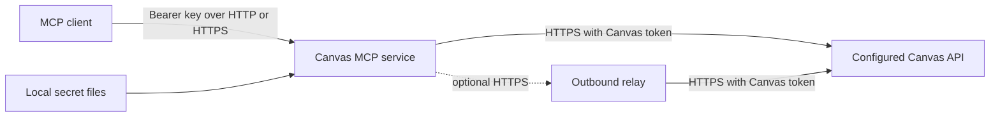

# Canvas LMS MCP

A self-hosted MCP server for the Canvas LMS API. It runs as an authenticated
Streamable HTTP service at `/mcp`, with Docker secret files and an optional
outbound relay. Each installation supplies its own Canvas URL and API token.
The repository contains no account data, course exports, or deployment secrets.

## What it exposes

- Course discovery and matching by name, code, or ID.
- Assignments, submissions, announcements, modules, discussions, pages, todos,
  and calendar events.
- A course dashboard combining assignments, missing submissions, and announcements.
- File metadata, text extraction, raw downloads, and MCP resources.
- Paginated API reads, a general Canvas API request tool, and header diagnostics.
- Capability discovery, structured output schemas, freshness metadata, and build fingerprints.

`READ_ONLY=true` is the default. Set it explicitly to `false` to enable write
methods through `canvas_request`. Every caller with the MCP key shares access
to the configured Canvas account; use a separate installation for each account.

## Run with Docker Compose

Requirements: Docker Engine and Docker Compose v2. From this directory:

```bash
cp .env.example .env
# Edit CANVAS_BASE_URL in .env to your Canvas HTTPS origin.
bash scripts/setup-secrets.sh
docker compose up --build -d canvas-mcp
curl --fail http://127.0.0.1:3000/healthz
```

The setup script prompts for your Canvas API token without echoing it. It
generates a separate random MCP key under `.secrets/`. Both `.env` and
`.secrets/` are ignored by Git and excluded from Docker builds. The secret
directory is accessible only to its owner; its files are readable by the
unprivileged container user when mounted individually.

Create a personal access token in your Canvas account settings if your
institution permits it. Supply an API token rather than an account password.
See the [Canvas authentication documentation](https://developerdocs.instructure.com/services/canvas/basics/file.oauth).

The service binds to `127.0.0.1:3000` on the host. `/healthz` and `/readyz`
provide public process status, without making a Canvas API request. `/health`
and `/mcp` require authentication.

## Connect an MCP client

Use `http://127.0.0.1:3000/mcp` for a local client and configure this header:

```text
Authorization: Bearer <contents of .secrets/mcp_key>
```

`X-MCP-Key` is also accepted. For clients that can configure only a URL, set
`MCP_ALLOW_QUERY_KEY=true` and use `/mcp?key=<your MCP key>`. URL credentials
can appear in proxy logs and browser history; use request headers when supported.
The server uses stateless Streamable HTTP; POST requests should accept both
`application/json` and `text/event-stream`. GET and DELETE at `/mcp` return 405.

For access from another machine, put an HTTPS reverse proxy in front of the
loopback port, preserve authentication headers, and set `ALLOWED_HOSTS` to
include your public hostname. Requests with an `Origin` header are rejected
unless the exact origin is listed in `ALLOWED_ORIGINS`. This service uses a
shared key; clients requiring OAuth discovery need a separate authentication
gateway. No particular gateway or hosting provider is required.

## Run directly with Node.js

Requirements: Node.js 24 or newer and npm.

```bash
npm ci
cp .env.example .env
# Set CANVAS_BASE_URL in .env.
bash scripts/setup-secrets.sh
npm start
```

`npm start` loads `.env` from the current directory. You can use
`MCP_URL_SECRET` and `CANVAS_TOKEN` environment variables instead of the
corresponding `_FILE` settings. A `_FILE` setting takes precedence. Optional
relay authentication also supports `CANVAS_RELAY_SECRET_FILE`.

## Configuration

| Setting | Purpose / default |
| --- | --- |
| `CANVAS_BASE_URL` | Required HTTPS Canvas origin; `/api/v1` suffix is accepted. |
| `CANVAS_TOKEN` / `CANVAS_TOKEN_FILE` | Canvas API token; required for direct access. |
| `MCP_URL_SECRET` / `MCP_URL_SECRET_FILE` | Required MCP access key, at least 24 characters. |
| `READ_ONLY` | `true`; blocks POST, PUT, PATCH, and DELETE to Canvas. |
| `HOST`, `PORT` | Node defaults: `127.0.0.1`, `3000`. |
| `ALLOWED_HOSTS` | Comma-separated hostnames accepted in the Host header. |
| `ALLOWED_ORIGINS` | Comma-separated exact browser origins; default empty. |
| `MCP_ALLOW_QUERY_KEY` | `false`; optionally accepts `?key=` authentication. |
| `CANVAS_USER_AGENT`, `CANVAS_ACCEPT`, `CANVAS_ACCEPT_LANGUAGE` | Optional outbound request headers. |
| `MAX_API_RESPONSE_BYTES` | `2000000`. |
| `MAX_FILE_BYTES` | `10000000`. |
| `MAX_TEXT_CHARS` | `200000`. |
| `MAX_REQUEST_BYTES` | HTTP JSON body limit; `2mb`. |
| `MCP_MAX_REQUESTS_PER_MINUTE` | Per-IP MCP limit; `120`. |
| `MCP_MAX_CONCURRENT_REQUESTS` | `8`. |
| `MCP_REQUEST_TIMEOUT_MS` | `65000`. |
| `CANVAS_RELAY_URL`, `CANVAS_RELAY_SECRET` | Optional HTTPS relay origin and shared secret, configured together. |
| `MCP_BUILD_ID`, `MCP_COMMIT`, `MCP_BUILT_AT` | Optional build metadata for your installation. |

Compose forwards the settings listed in `compose.yaml`. Add explicit environment
entries there if you need other settings. See [relay setup](relay/README.md)
and [troubleshooting](docs/troubleshooting.md).

## Architecture



`packages/mcp-core` contains tool registration, capability metadata, output
schemas, and error contracts. `packages/mcp-http-node` supplies the HTTP
transport, authentication, request limits, and health routes. They are included
as local npm workspaces, so a separate stack checkout is unnecessary.

## Development and privacy checks

```bash
npm ci
npm run type-check
npm test
npm run check:privacy
```

Tests use synthetic fixtures and local mock services. They do not connect to
a real Canvas account. The privacy check inspects tracked and untracked files
that Git would include, looking for private files, literal credentials, email
addresses, and machine-specific paths. It is a guard against accidental
commits, and requires a manual review of new data or documentation. CI also
scans Git history using [Gitleaks](https://github.com/gitleaks/gitleaks).

Canvas results can contain the installing user's personal information at
runtime. Treat tool output as private and avoid committing responses, logs,
screenshots, or downloaded coursework. See [security guidance](SECURITY.md).
